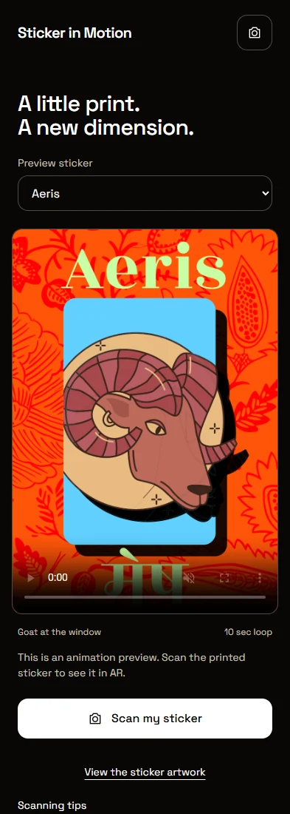
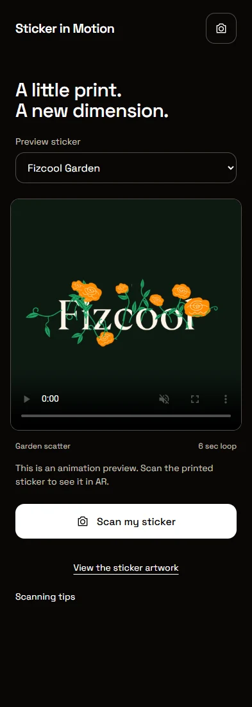

# Sticker in Motion

[](https://github.com/fizcool-debug/sticker-in-motion/actions/workflows/ci.yml)
[](LICENSE)

**A little print. A new dimension.**

An open-source Android AR sticker app by [Bhawesh Kumar / Fizcool](https://fizcool.in). Point your camera at a supported printed sticker and its animation appears above the artwork, following it as you move.

**[Download Android APK · v0.2](https://github.com/fizcool-debug/sticker-in-motion/releases/download/v0.2/Sticker-in-Motion-v0.2.apk)** · [Release notes](https://github.com/fizcool-debug/sticker-in-motion/releases/tag/v0.2) · [Contributing](CONTRIBUTING.md) · [Roadmap](ROADMAP.md)

The original app code is MIT-licensed. Sample artwork, fonts and dependencies have separate terms; see [Licensing and credits](#licensing-and-credits).

## A look inside

| Aeris preview | Fizcool Garden preview |
| --- | --- |
|  |  |

Actual browser captures of the app's paused preview screens, using the bundled artwork. These show the preview UI, not a physical-phone AR test.

## What it does

- Recognises four registered stickers and plays the matching animation.
- Tracks one sticker at a time, with pose smoothing and a replay control.
- Opens directly into a full-screen camera, keeping the artwork in focus.
- Includes a preview collection and original artwork views.
- Bundles recognition targets and animations locally for offline scanning.
- Processes camera frames on the device, without uploading them.
- Uses Android System WebView, with no ARCore dependency.

This recognises supported artwork; it does not animate arbitrary images.

## Install on Android

Requires **Android 7.0 or later**, camera access, and an up-to-date **Android System WebView**.

1. [Download the APK](https://github.com/fizcool-debug/sticker-in-motion/releases/download/v0.2/Sticker-in-Motion-v0.2.apk).
2. Open it on your phone and allow installation from that source when Android asks.
3. Launch **Sticker in Motion** and allow camera access.
4. Point the camera at a supported print in even light, keeping the whole sticker visible.
5. Move gently once it is recognised. Tap replay to start the animation again.

Open Preview to browse without scanning. The camera stops when the app goes into the background; choose **Resume camera** when you return.

The current release is a **debug-signed prototype for sideload testing**, not a Google Play release. A locally built APK uses your own debug key, so you may need to uninstall an existing build before installing it.

**v0.2 APK SHA-256**

```text
e6f5fd19172ac317c0bfcfae0c30a973a43dfa4dddc8e21f6facd36296fd6ed6
```

## The collection

| Sticker | Animation | Length | Artwork |
| --- | --- | --- | --- |
| Aeris | Goat emerges from its window and looks around | 10 seconds, 30 fps | [View](public/stickers/aeris/print-preview.png) |
| Fizcool Garden | Garden scatter | 6 seconds, 30 fps | [View](public/stickers/garden-fizcool/print-preview.png) |
| Red No Rush | Original animation | About 1.33 seconds, 6 fps | [View](public/stickers/red-no-rush/print-preview.png) |
| CET | Rainbow sweep and subtle pulse | 4 seconds, 15 fps | [View](public/stickers/cet/print-preview.png) |

CET's print is 4 × 4 inches. Print dimensions for the other stickers are not yet specified. Use the original print artwork rather than an animation frame for recognition.

## Run the web app

Use **Node.js 24** and npm. No API key or account is required to run the app.

```sh
git clone https://github.com/fizcool-debug/sticker-in-motion.git
cd sticker-in-motion
npm ci
npm run dev
```

Open the Vite URL, usually `http://localhost:5173`. Visit `/#preview` to browse the collection. Camera use on another device requires HTTPS; plain HTTP on a LAN address is not a secure camera context.

```sh
npm run build
npm run preview
npm test
```

The build checks TypeScript and writes `dist/`. The deterministic test checks pose smoothing; it does not establish real-world tracking performance.

## Build the Android app

Install **JDK 21**, **Android SDK 36**, and **Android build-tools 36.0.0**. Set `JAVA_HOME` and `ANDROID_HOME` to your installations.

On Windows:

```powershell
npm ci
npm run android:apk
```

The APK is copied to `artifacts/Sticker-in-Motion-debug.apk`.

On macOS or Linux:

```sh
npm ci
npm run android:sync
cd android
./gradlew assembleDebug
```

The APK is `android/app/build/outputs/apk/debug/app-debug.apk`. To use Android Studio, run `npm run android:open`. Keep SDK paths and signing keys out of Git.

## How it works

React and TypeScript provide the interface, MindAR handles image tracking, and Three.js renders the animation over the camera feed. Capacitor packages the web app and assets for Android.

Aeris and Garden use video textures. Red No Rush and CET use sprite atlases. The animation sits slightly above the print, and rigid-pose smoothing reduces visible shaking. Camera images stay on the device. The app does not request microphone or storage access.

| Path | Purpose |
| --- | --- |
| `src/stickers.ts` | Collection metadata and target indices |
| `src/tracking.ts` | Tracking, playback and lifecycle cleanup |
| `src/pose-stabilizer.ts` | Rigid-pose smoothing |
| `public/stickers/` | Bundled targets, artwork previews and animation assets |
| `assets/source/` | Supplied artwork and animation sources |
| `animation/` | Remotion compositions for CET and Aeris |
| `android/` | Capacitor Android project |
| `scripts/` | Asset preparation, validation and release tools |

## Make your own sticker

Add your artwork, animation assets, and entry in `src/stickers.ts`, then rebuild `public/stickers/collection.mind`. The current target order is Red No Rush (0), CET (1), Fizcool Garden (2), and Aeris (3); keep indices aligned with the compiled file.

For the optional browser tools:

```sh
npx playwright install chromium
npm run dev
# In another terminal:
npm run targets:compile
npm run test:browser
```

Use `APP_URL` to point tools at another development server, `PLAYWRIGHT_EXECUTABLE_PATH` for a locally installed Chromium browser, and `ADB_PATH` or `ANDROID_HOME` for native test tooling. Native WebView scripts expect an installed debug app and a forwarded DevTools socket; see [CONTRIBUTING.md](CONTRIBUTING.md).

See [the animation guide](animation/README.md) and [Aeris rebuild notes](animation/AERIS-PREVIEW.md) for editing compositions and rendering assets.

## Prototype status

Android build/signature checks, emulator lifecycle tests and synthetic-camera recognition checks have passed for the published v0.2 APK. Physical Redmi Turbo 5 checks remain pending, including alignment, glare, stability, heat and sustained performance. Browser and emulator fixtures are not physical-device evidence.

See [VALIDATION.md](VALIDATION.md), [CHANGELOG.md](CHANGELOG.md) and [ROADMAP.md](ROADMAP.md). Please report issues with your device, Android/WebView versions, lighting conditions and reproduction steps, without private camera images.

## Contribute

Bug reports, documentation fixes and focused pull requests are welcome. Read [CONTRIBUTING.md](CONTRIBUTING.md) before changing tracking or assets. For vulnerabilities, use the private reporting route in [SECURITY.md](SECURITY.md).

## Licensing and credits

- **Original source code:** [MIT License](LICENSE), copyright © 2026 Bhawesh Kumar.
- **Sample sticker artwork, logos, source artwork and rendered media:** retained by their respective creators. The code license does not grant rights to reuse this artwork or branding. Use your own licensed assets for derivative collections.
- **Fonts:** Space Grotesk and Rozha One retain their SIL Open Font License terms. The bundled Rozha One license is in [animation/public/aeris/OFL.txt](animation/public/aeris/OFL.txt); Space Grotesk's license is also copied to [public/licenses/SpaceGrotesk-OFL.txt](public/licenses/SpaceGrotesk-OFL.txt). Redistribution notices are included under public/licenses/ for future builds.
- **Dependencies:** retain their own licenses. In particular, Remotion and its Player use [Remotion's separate licensing terms](https://www.remotion.dev/docs/license), not this project's MIT license.

See [NOTICE.md](NOTICE.md) for scope and third-party notices.
